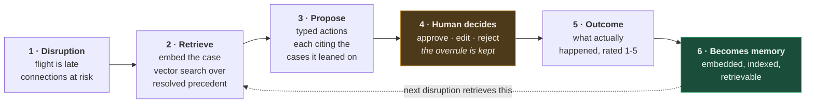
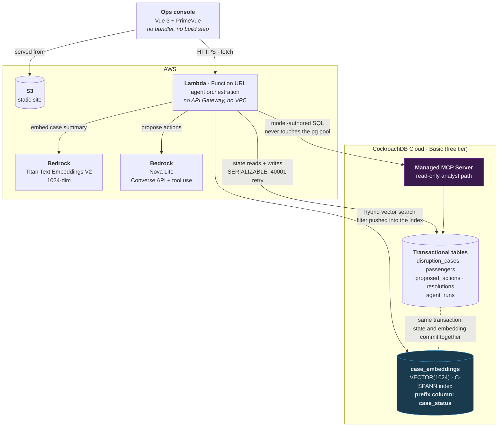

# IROPS Disruption Memory Agent

An operational-memory agent for airline irregular-operations (IROPS) desks.
Every resolved disruption becomes retrievable precedent that improves the
handling of the next one.

Built for the **CockroachDB × AWS Hackathon — "Build with Agentic Memory."**

### ▶ [Open the live demo](https://irops-memory-demo-21.s3.us-east-1.amazonaws.com/index.html) · 🎬 [Watch the 3-minute demo](https://www.youtube.com/watch?v=9s4SiUE9Bvw)

Nothing to install, no login. All data is synthetic.

<table>
<tr><td><b>Judging in 5 minutes?</b> Do this:</td></tr>
<tr><td>

1. **Open flight ZZ1137** from the caseload — 190′ late, 23 misconnecting.
2. Look at **Recommended plan**. Each group cites past disruptions as chips like
   `ZZ4381 · 5/5 · worked`. **Click one.** That is a real case the agent
   retrieved by vector similarity, with the outcome it actually produced.
3. Hit **Approve all** in the bar at the bottom, then open **Evidence → Agent run** to see the model,
   token counts and the exact case ids the plan was built from.
4. Click the **chat bubble, bottom right**, and ask *"which cause had the worst
   average outcome rating?"* The answer arrives with the SQL it ran, executed
   read-only through CockroachDB's Managed MCP Server.
5. Resolve a case with an outcome note — it is embedded and becomes retrievable
   precedent for the next disruption. That is the loop closing.

</td></tr>
</table>

| | |
|---|---|
| **Demo video** | https://www.youtube.com/watch?v=9s4SiUE9Bvw |
| **Live demo** | https://irops-memory-demo-21.s3.us-east-1.amazonaws.com/index.html |
| **API health** | https://7p2mkku36rbgbj2chqcsers5qy0gkccu.lambda-url.us-east-1.on.aws/api/health |
| **CockroachDB** | Vector index (C-SPANN) with a **prefix column**, SERIALIZABLE txns, Managed MCP Server, Agent Skills |
| **AWS** | Lambda Function URL, Bedrock (Titan Embeddings V2 + Nova Lite), S3 |
| **Stack** | TypeScript / Node 22, Vue 3 + PrimeVue, no bundler |
| **Data** | 84 synthetic disruptions, 81 resolved outcomes — [provenance](#data-provenance) |

---

## The problem

When a flight is disrupted, ops staff must decide fast: who gets rebooked
where, which misconnecting passengers are recoverable, who needs priority
handling. Every disruption is handled largely from scratch. The institutional
knowledge of *"we saw this exact shape of disruption last month and here is
what actually worked"* lives in people's heads and evaporates with staff
turnover.

Traditional systems store **records**. They do not store **judgement**.

## What this does

```
new disruption arrives
  → agent builds a structured summary and embeds it
  → hybrid search over past cases in CockroachDB
      (semantic similarity AND a hard filter, in one indexed operation)
  → retrieves precedent + THE OUTCOMES those precedents produced
  → reads current state (passengers, connections, priority)
  → proposes typed, reviewable actions citing specific precedents
  → human approves / edits / rejects
  → outcome is written back, embedded, and becomes precedent
```

**Why this is not a chatbot:** the agent proposes typed actions against state,
records the human's decision, and its future behaviour changes because of what
it recorded. Memory is the product, not a feature.

**Rejected proposals are memory too.** An agent that records what humans
overruled is more useful than one that only records its successes — the
overrule is the strongest signal in the dataset.

---

## Data provenance

**All data in this repository and its demo is synthetic**, generated by
[`src/seed/`](src/seed/). There is no real passenger data, no real booking
references, no real customer names. The carrier code is fictional, passenger
references use an obviously-synthetic format, and aircraft are described by
generic size class. Airport codes are real IATA identifiers — public
infrastructure references — arranged into a network that deliberately does not
reproduce any actual carrier's route structure.

The provenance rules are documented at the top of
[`src/domain/vocabulary.ts`](src/domain/vocabulary.ts).

Outcome notes — the free text a desk writes when it closes a case, and the
string a reviewer reads on a retrieved precedent — are composed from each
case's own facts in
[`src/domain/outcome-notes.ts`](src/domain/outcome-notes.ts) rather than picked
from a bank of stock sentences. The first version did pick from a bank, and 81
resolutions ended up sharing 13 distinct strings; two precedents opened side by
side read identically, which is precisely the moment the memory claim is
supposed to land.

The cause mix is deliberately **balanced rather than realistic**. Real
on-time-performance data has weather as a single-digit percentage of primary
causes; here it is 25%, because a realistic distribution would leave too few
cases per cause for retrieval to have anything to retrieve. Delay *shapes* are
kept plausible per cause — ATC restrictions clear (avg 60′, max 71′),
engineering does not (avg 202′, max 352′).

---

## Architecture

### The memory loop

The claim is that handling improves because of what was recorded, so the loop
has to close. Step 6 is the whole product — it is what makes step 2 useful next
time.



### The wiring



Two things in that second diagram are the technical argument:

- **`prefix column: case_status`** — the structured filter is pushed *into* the
  vector index rather than applied to its output. Proof below.
- **The model-authored SQL takes a different road.** Application queries use the
  `pg` pool; anything the LLM writes goes through MCP, which is a governed
  gateway with per-call RBAC and one statement per call. The two paths never
  meet.

No API Gateway, no ALB, no VPC — see [Cost](#cost) for why.

### The point of CockroachDB here

Vectors and transactional rows live in **one** system. There is no ETL job and
no consistency gap between "what the agent remembers" and "what actually
happened" — the embedding write and the state write commit in the same
transaction. A separate vector database would reintroduce exactly the drift
this design exists to avoid.

### Hybrid retrieval is real, not a post-filter

The retrieval query filters to resolved cases *and* ranks by cosine similarity
in a single indexed operation. `EXPLAIN` proves it:

```
• vector search
    table: case_embeddings@idx_case_embeddings_status_vec
    target count: 5
    prefix spans: [/'resolved' - /'resolved']
```

`prefix spans` is the important line. The structured filter is pushed **into**
the vector index as a span — not applied afterwards to an approximate-nearest-
neighbour result set. That is what a **prefix column** on a CockroachDB vector
index buys, and it is the strongest technical claim in this project.

Reproduce it yourself: `npm run verify:schema`.

---

## CockroachDB tools used

| Tool | How it is used |
| --- | --- |
| **Distributed Vector Indexing** | The core retrieval path. Remove it and the product stops working. `VECTOR(1024)` columns with `vector_cosine_ops` and a `case_status` prefix column for hybrid filtering. |
| **ccloud CLI** | Cluster provisioning, scripted and committed: [`scripts/provision-cluster.ps1`](scripts/provision-cluster.ps1). |
| **Managed MCP Server** | The **read-only analyst path**, at runtime. Ask the memory layer a question in English on the Memory view; the model writes SQL and it executes through the Managed MCP Server. See [How read-only is really enforced](#how-read-only-is-really-enforced). |
| **Agent Skills Repo** | Applied to this codebase; three skills produced real changes. See [What the Agent Skills changed](#what-the-agent-skills-changed). |

### How read-only is really enforced

This is worth stating precisely, because the obvious phrasing would be wrong.

The MCP analyst does **not** hold a read-only credential — there is no such
thing. CockroachDB Cloud requires an MCP service account to hold **Cluster
Operator or Cluster Admin**; no read-only role is accepted. We verified the
consequence against the live server: `insert_rows`, `create_table` and
`create_database` **are offered to our key**.

Read-only is therefore a property of *this application*, enforced in three
layers:

1. **Tool allowlist** — [`src/mcp/analyst.ts`](src/mcp/analyst.ts) will only
   dispatch `select_query`, `get_table_schema` and `list_tables`. Any other
   tool is refused before it reaches the wire, even if the model asks for it
   and the server would honour it.
2. **Statement check** — every generated statement must be a `SELECT`/`WITH`,
   with no chaining, no DDL/DML keywords, and no system schemas.
3. **Server-side limits** — the MCP server independently enforces one statement
   per call, a 20-second timeout, a 10 KiB response cap and blocked system
   schemas.

Verify layers 1 and 2 yourself: `node scripts/analyst-guardrails.mjs` exercises
the boundary with the inputs a compromised model would produce — DDL, DML,
statement chaining, chaining hidden behind comments, writing CTEs, system-schema
access — 20 cases.

The application's own writes never touch this path. They go over the ordinary
Postgres connection as fixed, parameterised SQL that no model ever sees.

### What the Agent Skills changed

Installed from [cockroachlabs/cockroachdb-skills](https://github.com/cockroachlabs/cockroachdb-skills)
and applied on 2026-08-04. Three produced real changes; the rest did not apply
to a single-region demo and were not force-fitted.

| Skill | What it found | What changed |
| --- | --- | --- |
| `designing-application-transactions` | No retry handling for `40001` serialization failures, in any of the three explicit transactions. CockroachDB defaults to SERIALIZABLE and expects the client to retry. | Added `withTransaction` in [`src/db.ts`](src/db.ts) — exponential backoff with jitter, applied to all three sites. Deliberately does **not** retry `40003` (ambiguous commit — our transactions are not idempotent) or `23xxx` (constraint violations). |
| `cockroachdb-sql` (query & schema design) | `idx_cases_status_created` was on `(status, created_at DESC)` but the case-list query orders by `scheduled_dep` — so the index could never serve it. `EXPLAIN` showed a **full scan** on the hottest read. | [`migrations/002_query_alignment.sql`](migrations/002_query_alignment.sql) replaces it with `(status, scheduled_dep DESC) STORING (…)`. Plan went from `FULL SCAN` + a sort node to a `LIMITED SCAN` on the index with **no sort at all**. |
| `auditing-table-statistics` | Optimizer statistics were stale: `disruption_cases` estimated at 52 rows (actual 84), `case_embeddings` at **0** (actual 84). | `ANALYZE` in migration 002, and the seed script now refreshes statistics after its bulk load — which is where the drift originates. |

The statistics finding also retroactively justified an earlier decision: during
M1 the optimizer recommended a covering index on `case_embeddings(case_status)`
that would have replaced vector search with a scan. That was ignored on the
grounds that the optimizer had no statistics on an empty table. `SHOW
STATISTICS` confirms it — the recorded row count really was `0`.

**Honest note:** at 84 rows none of these changes are measurable in wall-clock
time. The index/query mismatch was a genuine defect regardless of scale, and the
retry gap is a correctness issue that only appears under concurrency — which is
exactly what a month of judging traffic provides.

## AWS services used

| Service | How it is used |
| --- | --- |
| **Amazon Bedrock** | `amazon.titan-embed-text-v2:0` for embeddings, `amazon.nova-lite-v1:0` for reasoning via the Converse API. Load-bearing, not decorative. |
| **AWS Lambda** | Agent execution, behind a Function URL. |
| **Amazon S3** | Static frontend hosting. |

---

## Setup from zero

Verified end to end on a clean machine. Each step has a check you can run.

### Prerequisites

- Node.js 20+
- A CockroachDB Cloud account (Basic plan — **no credit card**)
- An AWS account (Bedrock is not free-tier; see [Cost](#cost))

### 1. Clone and install

```bash
npm install
```

### 2. Provision the database

Install the [ccloud CLI](https://www.cockroachlabs.com/docs/cockroachcloud/ccloud-get-started),
then:

```bash
ccloud auth login
```

```powershell
powershell -ExecutionPolicy Bypass -File ".\scripts\provision-cluster.ps1"
```

Create a SQL user and fetch the connection string:

```bash
ccloud cluster user create irops-memory irops_app
```

```bash
ccloud cluster connection-string irops-memory --sql-user irops_app --database defaultdb
```

> **Note on the published Windows ccloud zip:** it contains the binary named
> `ccloud` with **no `.exe` extension**, so the install snippet in the official
> docs fails at its final copy step. Rename it when installing.

### 3. Configure

```bash
cp .env.example .env
```

Fill in `DATABASE_URL` (splice in the password from step 2) and, for the real
providers, `AWS_ACCESS_KEY_ID` / `AWS_SECRET_ACCESS_KEY`. `.env` is gitignored.

### 4. Migrate and verify

```bash
npm run migrate
```

```bash
npm run verify:schema
```

The second command asserts the schema matches intent **and** that retrieval is
index-accelerated rather than silently degraded to a full scan.

### 5. Check Bedrock (optional but recommended)

```bash
npm run check:bedrock
```

Confirms credentials, IAM scope, model access, quota, and that embeddings rank
related text closer than unrelated text — in one run, before any integration
code depends on it.

### 6. Seed synthetic history

```bash
npm run seed -- --reset
```

~84 cases, ~1,500 passengers, deterministic from a seed. Then check retrieval
actually works:

```bash
npm run check:retrieval
```

### 7. Run it

```bash
npm run dev
```

Open <http://localhost:3000>.

### Running with no cloud services at all

The app boots with zero credentials:

```
EMBEDDING_PROVIDER=fake
LLM_PROVIDER=heuristic
```

`fake` embeddings use feature hashing — deterministic, offline, and good enough
that retrieval quality is developable without spending anything. `heuristic` is
a hand-written decision tree, **not a language model**; it exists so the loop
and UI can be built offline and as a baseline for Bedrock to beat. Neither is
ever used as a silent fallback: if a real provider is configured and fails, the
failure surfaces.

---

## Live demo

**<https://irops-memory-demo-21.s3.us-east-1.amazonaws.com/index.html>**

> The `/index.html` is required. S3 offers two endpoints for the same objects
> and neither does both things: the **website** endpoint
> (`s3-website-…`) handles index-document routing but is **HTTP-only** — it has
> no TLS listener, so `https://` fails with a connection reset. The **REST**
> endpoint (`s3.…`) serves HTTPS but has no index-document concept, so the path
> must be spelled out and the bare root returns 403.
>
> The HTTPS one is what gets shared, because any browser configured to upgrade
> HTTP to HTTPS would otherwise show a connection error and nothing else.
> CloudFront in front of the bucket would give both at once, at the cost of
> another moving part to keep alive through judging.

---

## Deploying

The demo is a Lambda Function URL plus an S3 static site.

You need an IAM **execution role** for the Lambda (trusted by
`lambda.amazonaws.com`) with `AWSLambdaBasicExecutionRole` and one inline
statement allowing `bedrock:InvokeModel`. Create it in the console — the deploy
script deliberately does **not** create it, so the deploying user never needs
`iam:CreateRole`.

```powershell
powershell -ExecutionPolicy Bypass -File ".\scripts\deploy.ps1" -RoleArn "<role-arn>" -BucketName "<globally-unique-bucket>"
```

> In this deployment the role happens to be named `bedrock-invoke` and its
> Bedrock policy `irops-lambda-execution-role`. IAM names are immutable and
> purely labels; the script takes the ARN as a parameter, so the names do not
> matter.

### Secrets

`DATABASE_URL` and the model IDs are passed as **Lambda environment
variables**, read from `.env` at deploy time. They are never committed, never
printed, and are assembled into a temp file rather than interpolated into a
command line (which would put them in shell history and process listings).

The deployed Lambda receives its AWS credentials from its **execution role** —
no static keys are ever sent to it.

For a production system, AWS Secrets Manager with rotation would be the
stronger choice. For a single-function demo, Lambda environment variables
encrypted at rest are proportionate. Documented here rather than left implicit.

### CORS

The API allows any origin. This is deliberate: the frontend is on S3 and the
API on a Lambda Function URL, so they are always cross-origin, and the API is
intentionally public so judges can use the demo without credentials. CORS is
not an authorization mechanism and restricting it would protect nothing. The
real controls are that no action is ever auto-executed, every write is
parameterised and schema-validated, and model output is grounded before it can
touch the database.

---

## Cost

The demo must stay live for a month of judging on no budget, so the
architecture is chosen to scale to zero:

- **Lambda Function URL**, not API Gateway or an ALB — no hourly charge, and
  idle costs nothing. An ALB alone would be ~$30–50 for the judging window.
- **No VPC** — CockroachDB Cloud is publicly reachable, and a VPC would need a
  NAT gateway (~$32/month) just to reach Bedrock.
- **No embedding on page load.** Reading a case returns the precedents from its
  last agent run. The agent only runs on an explicit POST.
- **CockroachDB Basic**: 10 GiB and 50M Request Units free per month.

Measured Bedrock pricing at this volume: **under $1 total** for the whole build
plus judging window. Full workings in [NOTES.md](NOTES.md) §6.

---

## Production-readiness notes

- **Nothing is auto-executed.** Proposals persist as `proposed` and a human
  decides. Enforced by CHECK constraints, not convention.
- **Model output is grounded, not just schema-validated.** A model can emit
  perfectly valid JSON citing a precedent that was never retrieved, or naming a
  passenger who is not on the flight. Those are stripped: a fabricated citation
  is removed but the action survives; a fabricated passenger reference kills the
  action outright. For an agent whose pitch is "it cites its precedents", an
  uncheckable citation is worse than none — it looks like evidence.
- **Every run is logged**, including failures, with real token counts and
  latency (`agent_runs`).
- **Failure paths are tested, not asserted**: `npm run check:guardrails`.
- **Embedding-model mismatch is refused.** Querying with a different model from
  the one that wrote the stored vectors returns confident, ordered, meaningless
  results with nothing erroring. The app refuses to start in that state.
- Parameterised queries only; timeouts on database and model calls; a per-case
  cap on model invocations.

---

## Honest status

Things that are true but easy to overstate, recorded plainly:

- **CockroachDB vector indexing** shipped in v25.2 described as Preview. No
  official GA statement was found. It is enabled by default on a managed
  free-tier cluster (v26.2.1) and works, but this README will not claim "GA".
- **The `heuristic` provider is not an LLM.** It is a decision tree for offline
  development. It is never the demo path.
- **Retrieval benchmark numbers favour the fake embedder by construction.** The
  metric scores agreement on labels that are literally words in the summary
  text, which is what lexical matching is unbeatable at. Titan generalises to
  paraphrases the fake cannot see. See [NOTES.md](NOTES.md) §4A.4.
- **`passengers` holds a capped sample of each manifest**, 3–30 rows against
  cases carrying up to 285 passengers, to keep a free-tier cluster small. The
  UI says "25 tracked" for exactly this reason. `disruption_cases` carries the
  authoritative totals (`pax_count`, `misconnect_count`, `priority_pax_count`),
  and any aggregate over `passengers` is a sample statistic.
- **The MCP analyst can be confidently wrong, and the UI is built for that.**
  Two real failures, both caught by reading the rows shown with the answer:
  asked which cause had the *worst* outcome it ordered `DESC` and read the top
  row, reporting the best cause as the worst; asked which case caused the most
  trouble it ranked by counting `passengers` rows — the sampled table above —
  and returned a case with 62 misconnections ahead of one with 113. Prompt
  rules fixed both. Nothing makes a model's arithmetic reliable, so every query
  **and the rows it returned** are shown alongside the answer. Treat the answer
  as a claim with its evidence attached, not a result.
- **`Cluster Operator` is more privilege than the analyst needs**, and is the
  minimum the platform allows for MCP. See
  [How read-only is really enforced](#how-read-only-is-really-enforced).

---

## Tool feedback

Written for the sponsors. Everything here was hit during this build and is
recorded with the evidence in [NOTES.md](NOTES.md); nothing is second-hand.

### CockroachDB — what earned its place

**Prefix columns on a vector index are the best feature here and the most
undersold.** Hybrid retrieval is usually a compromise: ANN first, filter after,
hope enough survives. A prefix column pushes the structured filter *into* the
index as a span, and `EXPLAIN` proves it rather than implying it:

```
• vector search
    table: case_embeddings@idx_case_embeddings_status_vec
    prefix spans: [/'resolved' - /'resolved']
```

This is the single most important line in this project's design, and it is
documented as one bullet among many in the Vector Indexes page. It deserves to
be a headline with a worked hybrid-search example.

**Vectors and rows in one transaction removes a whole class of bug.** The state
write and the embedding write commit together. No ETL, no drift between what
the agent remembers and what happened. That argument sells itself; there just
isn't a doc page making it.

**Agent Skills found three real defects, not style nits.**
`designing-application-transactions` caught that nothing anywhere retried
`40001` — a correctness bug that only shows up under the concurrency a month of
judging supplies. `cockroachdb-sql` caught an index on `created_at` serving a
query that orders by `scheduled_dep`, i.e. a FULL SCAN on the hottest read.
`auditing-table-statistics` caught stale stats — 52 estimated rows against 84
actual, and `case_embeddings` at **0**, which retroactively explained why an
earlier optimizer index recommendation had looked odd. That is a genuinely
strong showing.

### CockroachDB — what cost time

**The MCP Server has no read-only role, and the docs read as though it does.**
The documentation describes read-only mode and an `mcp:read` scope. In practice
a service account needs **Cluster Operator** (org-scoped is not enough — it must
be scoped to the cluster), and with that role **all 12 tools are on the wire**,
`insert_rows` and `create_table` included. Read-only became a property of *our
client's allowlist*, not of the credential. For a hackathon whose brief asks
people to use MCP safely, a true read-only role would be the highest-value thing
you could ship. Verified live: `npm run check:mcp`.

**The unauthorized failure mode is silent.** A key with no cluster-scoped role
authenticates cleanly, lists tools cleanly, then fails every data call with a
bare `unauthorized`. The tell is `list_clusters` returning `{"rows":[]}` — an
empty list, not an error — so "bad key" and "no role" are indistinguishable
without knowing to look. An error naming the missing role would have saved an
hour.

**Two official pages disagree on whether vector indexing must be enabled.** The
Vector Indexes page instructs `SET CLUSTER SETTING feature.vector_index.enabled
= true`; the Cluster Settings reference lists it as default `true`. The
reference is correct on v26.2.1 — the setting is already on and no `SET` is
needed. Related: v25.2 shipped the feature described as Preview, and we could
find no statement that it has reached GA, so this README declines to claim one.
A dated status line on the feature page would settle both.

**A Postgres-compatibility edge worth documenting.** A comma-joined
set-returning function scopes its alias differently than an explicit `JOIN`, so
mixing the two fails with `no data source matches prefix`. Moving `unnest()`
into a CTE fixed it. Minor, but it cost a debugging cycle because the error
points at the alias rather than the construct.

**`ccloud` on Windows ships a binary with no `.exe` extension**, so the install
snippet in the docs fails on its final copy. Confirmed it really is the
executable by its magic bytes (`0x4D 0x5A`, a PE header) and renamed it on
install — see [`scripts/provision-cluster.ps1`](scripts/provision-cluster.ps1).
A one-line fix in the docs.

### AWS — what earned its place

**Lambda Function URLs are the right primitive for this.** No API Gateway, no
ALB, no VPC, scale-to-zero, and the deploy stays a zip upload. For a demo that
must stay reachable for a month on a free tier, that is exactly the shape
needed.

**Bedrock's Converse API made tool use portable.** One `toolConfig` shape drove
both the planning agent and the MCP analyst's loop, with `stopReason` cleanly
distinguishing `tool_use` from `max_tokens`. Titan Text Embeddings V2 at 1024
dimensions was a drop-in — `normalize` defaults to true, which is the behaviour
cosine similarity wants.

### AWS — what cost time

**A Function URL returns 403 with a textbook-correct resource policy.** Since
October 2025 the invoke permission requires **both** `lambda:InvokeFunctionUrl`
*and* `lambda:InvokeFunction`. The docs are explicit that this applies "even if
the function URL uses the `NONE` auth type" — but that sentence is easy to miss,
and every older tutorial grants one permission. The 403 body says nothing about
which permission is absent.

**Setting CORS in two places produces a browser-only failure.** With headers on
both the handler and the Function URL config, the response carries duplicate
`Access-Control-Allow-Origin` and browsers reject it — while `curl` reports a
perfectly healthy 200. "Works in curl, fails in browser, no useful console
message" is a bad afternoon. Letting the Function URL own CORS fixed it.

**`AllowMethods` rejects `OPTIONS`** because members are capped at 6 characters.
The error is about string length, which is a confusing way to learn that
preflight is handled for you and must not be listed.

**S3 static hosting makes you choose between HTTPS and index documents.** The
website endpoint does index-document routing but is HTTP-only; the REST endpoint
serves HTTPS but has no index-document concept, so the URL must end in
`/index.html` and the bare root 403s. Any browser upgrading HTTP to HTTPS breaks
the first one. CloudFront solves it at the cost of another component to keep
alive through judging.

**The AWS CLI echoes an unparseable payload — including its secrets.** Feeding
it a JSON file written by PowerShell's `Set-Content -Encoding utf8` fails,
because that emits a BOM and the CLI cannot parse it (`Expected: '=', received:
'<BOM>'` — a cryptic way to say "byte order mark"). The CLI then **printed the
offending payload to the console, connection string and password included.**
Two fixes worth making upstream: don't echo request payloads on parse failure,
and name the BOM in the error. Our side now writes with
`[System.IO.File]::WriteAllText` and routes all CLI output through a redactor.

---

## Repository map

| Path | What it is |
| --- | --- |
| [`SPEC.md`](SPEC.md) | Design spec and dated progress log |
| [`NOTES.md`](NOTES.md) | Verified API research — every external claim, with links and quotes |
| `migrations/` | Schema, with the reasoning inline |
| `src/domain/` | Shared vocabulary and `summary_text` generation |
| `src/seed/` | Synthetic data generator |
| `src/agent/` | Retrieval, prompt, validation, orchestration |
| `src/providers/` | Embedding and LLM providers behind one interface |
| `src/api/` | Transport-agnostic HTTP router + Lambda and local adapters |
| `web/` | Ops console — Vue 3 + PrimeVue from vendored UMD, no bundler, no build step |
| `scripts/` | Provisioning, migration, verification, deployment |

## License

MIT — see [LICENSE](LICENSE). Copyright (c) 2026 Orest Mucaj.
